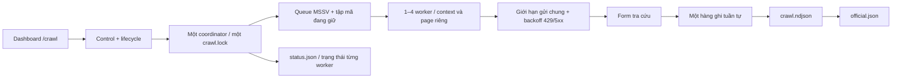

# ca nào z? 🎓

> "Ủa tụi mình cùng ca không?" — One-page React website tra ca tốt nghiệp theo **tên (không dấu)** hoặc **MSSV (2 chữ + 6 số)**. Kết hợp dữ liệu trường đã crawl với ca do bạn bè tự khai qua Google Form/Sheets. API ưu tiên dữ liệu trường theo MSSV và chỉ trả MSSV đã che cho trình duyệt.

## 1. Mở thử ngay (dữ liệu giả)

Yêu cầu: Node.js **20.19+** (khuyến nghị Node 22).

```bash
npm install
cp .env.example .env
npm run dev
```

Mở `http://localhost:5173`. Mặc định có **DEMO MODE** với 12 bản ghi hoàn toàn hư cấu. Thử tìm `Nguyễn Minh Anh` hoặc `AB123456`, chọn Ca 1 / 2 / 3.

Các lệnh khác:

```bash
npm test       # kiểm tra regex, tìm tiếng Việt, lọc ca, ẩn MSSV
npm run build  # tạo production dist/
npm run preview
```

## 2. Tạo Google Form (miễn phí)

1. Vào https://forms.google.com, tạo Form tên `Ca Nào Z? - Khai ca tốt nghiệp`.
2. Tạo **đúng** các câu hỏi dưới đây (để API tự nhận diện header), theo thứ tự tùy ý:

   | Tên câu hỏi **chính xác** | Kiểu | Thiết lập |
   | --- | --- | --- |
   | `Họ và tên` | Short answer | Required |
   | `MSSV` | Short answer | Required; Response validation → Regular expression → Matches: `^[A-Za-z]{2}[0-9]{6}$` |
   | `Ca tốt nghiệp` | Dropdown | Required; chọn `Ca 1`, `Ca 2`, `Ca 3` |
   | `Lớp / nhóm` | Short answer | Optional |
   | `Đồng ý công khai` | Checkboxes | Required; **chỉ một option**: `Tôi đồng ý` |

3. Trong mô tả Form, giải thích: tên, ca, nhóm (nếu có) sẽ xuất hiện công khai; **chỉ hiện MSSV dạng che bớt**; việc khai thông tin là tự nguyện và có cách yêu cầu sửa/xóa.
4. Tắt thu thập email nếu không cần. Không bật giới hạn "1 phản hồi" nếu muốn mọi người điền không đăng nhập; bản ghi đồng ý công khai sẽ hiện tự động.
5. Tab **Responses** → **Link to Sheets** → tạo bảng tính mới.
6. Lấy URL gửi form qua **Send/Publish/Share → copy link** (giao diện Google có thể thay đổi). Sau này dùng làm `VITE_FORM_URL`.

## 3. Google Sheets — dữ liệu công khai tự động

- Mở bảng tính phản hồi, xác nhận tên tab (thường `Form Responses 1` hoặc `Câu trả lời biểu mẫu 1`). Tên này cần điền vào `SHEET_NAME` trong `apps-script/Code.gs`.
- Hàng nào chọn **`Tôi đồng ý`** và có tên, MSSV, ca hợp lệ sẽ hiện trên web ngay sau khi Google Form ghi vào Sheet. Không cần cột `Duyệt`; nếu đã thêm cột này, bạn có thể giữ lại nhưng API sẽ bỏ qua.
- Nếu cần sửa ca/tên, sửa trực tiếp trong Sheet. Nếu cần ẩn một bản ghi, xóa giá trị `Đồng ý công khai` của dòng đó hoặc xóa dòng theo chính sách dữ liệu của bạn.
- **Không chọn** File → Share → Anyone with link; giữ Sheet ở chế độ riêng tư.
- Nếu trùng MSSV, bản ghi **đồng ý công khai** mới hơn sẽ hiển thị. MSSV chỉ được kiểm tra định dạng, không chứng minh người gửi là chủ MSSV; người biết MSSV của người khác có thể khai sai thông tin.

## 4. Google Apps Script — API riêng tư

1. Từ Sheet chọn **Extensions → Apps Script**.
2. Copy toàn bộ `apps-script/Code.gs` vào code editor. Nếu tab không phải `Form Responses 1`, sửa `SHEET_NAME`. Với deployment đang dùng, vào **Deploy → Manage deployments → Edit → New version → Deploy** sau khi thay code.
3. Trong Apps Script chọn **Project Settings (bánh răng) → Script properties → Add script property**:
   - Property: `API_TOKEN`
   - Value: một chuỗi bí mật dài ngẫu nhiên (ví dụ tạo bằng `openssl rand -hex 24` trong terminal).
4. **Deploy → New deployment → Web app**:
   - Execute as: **Me**
   - Who has access: **Anyone** (nếu tài khoản Workspace không cho phép, cần tài khoản Google cá nhân hoặc cấu hình khác).
5. Cấp quyền theo hướng dẫn Google và copy URL dạng `https://script.google.com/macros/s/.../exec`.
6. Apps Script chỉ phản hồi JSON cho POST có **token đúng**. Đừng paste token vào React, đừng public Sheet.

**Lưu ý:** "Anyone" là truy cập kỹ thuật đến endpoint của Script; khóa token là một rào cản cơ bản, **không phải hệ thống chống abuse/rate limit hoàn chỉnh**. Dữ liệu chỉ được lộ theo từng query, nhưng search tên và lọc ca vẫn cho phép xem các bản ghi đồng ý công khai. Không phù hợp để lưu dữ liệu nhạy cảm.

## 5. Deploy Vercel

1. Chạy `npm run crawl:export` để xuất kết quả crawl tìm thấy vào `server-data/official.json`. Commit source và snapshot này vào repo (không đưa `.env`, Excel, checkpoint hoặc log vào Git). Snapshot chứa tên và MSSV đầy đủ; repo public sẽ công khai nội dung file này.
2. Vào https://vercel.com/new → Import repo → chọn Vite (nếu hỏi) → Build command `npm run build`, Output directory `dist`.
3. Trong **Project Settings → Environment Variables**, thêm:

   | Tên biến | Giá trị | Public? |
   | --- | --- | --- |
   | `VITE_DEMO_MODE` | `false` | Có |
   | `VITE_DATA_SOURCE` | `hybrid` | Có |
   | `SEARCH_SOURCE` | `hybrid` | **Không, server-only** |
   | `VITE_FORM_URL` | Public URL của Google Form | Có |
   | `VITE_CORRECTION_URL` | Form riêng để đề nghị sửa/xóa (khuyến khích) | Có |
   | `SHEETS_API_URL` | URL `/exec` của Apps Script | **Không, server-only** |
   | `SHEETS_API_TOKEN` | Cùng chuỗi với `API_TOKEN` của Script | **Không, server-only** |

4. Deploy. Link miễn phí sẽ có dạng `https://<ten-du-an>.vercel.app` tùy tên khả dụng. Sau mỗi lần đổi `VITE_*`, cần redeploy vì giá trị được đóng gói vào client khi build.
5. Truy cập website → chọn ca / nhập tên → xem dữ liệu trường kết hợp đăng ký bổ sung đã đồng ý công khai. Mỗi kết quả có ghi nguồn. Cần deploy phiên bản `apps-script/Code.gs` mới để hỗ trợ lọc trùng hai nguồn.

## 6. Lịch ba ca

Lịch hiển thị trong mảng `shifts` ở `src/App.jsx`:

| Ca | Check-in | Trao bằng |
| --- | --- | --- |
| 1 | 6:00–6:50 | 7:00–9:30 |
| 2 | 9:00–9:50 | 10:00–12:30 |
| 3 | 13:00–13:50 | 14:00–16:30 |

Khi lịch thay đổi, sửa `checkin` và `ceremony` của ca tương ứng, rồi đẩy mã lên GitHub để Vercel triển khai giao diện mới.

## 7. Về sửa/xóa thông tin

Khuyến khích tạo một Google Form khác gồm `MSSV`, `Yêu cầu: sửa/xóa`, `Thông tin cần sửa`, `Cách liên hệ` (không hiển thị trên web); điền link vào `VITE_CORRECTION_URL`. Trước khi sửa/xóa, chủ trang phải xác minh người gửi yêu cầu là chủ dữ liệu bằng cách phù hợp (MSSV không phải chứng thực danh tính). Không đưa thông tin liên hệ vào trang tra cứu.

## 8. API interface

Public website gọi Vercel Function:

```text
GET /api/search?q=nguyen%20minh%20anh
GET /api/search?q=AB123456
GET /api/search?shift=3
GET /api/search?q=an&shift=3
```

Vercel Function gọi Apps Script qua POST **server-to-server**, không gửi secret lên browser. Response ví dụ:

```json
{
  "ok": true,
  "results": [
    {"name":"Nguyễn Minh Anh","shift":3,"group":"Thiết kế","studentIdMasked":"AB****56"}
  ]
}
```

Không dùng `GET /api/search` để dump toàn bộ Sheet; phải có query tên/MSSV hoặc filter ca. Kết quả được giới hạn 40 bản ghi mỗi lần để giữ MVP gọn. Nếu lượng sinh viên lớn, hãy bổ sung pagination, cache và chống abuse trước khi scale.

## 9. Lưu ý vận hành

- **React + Vite** chạy local ở demo mode; khi dùng backend thật, dùng Vercel deploy hoặc `vercel dev` thay `vite dev` để có route `/api/search`.
- Google Apps Script có quota và độ trễ; miễn phí không đồng nghĩa chịu được lượng lớn truy cập cùng lúc.
- Form có thể bị spam hoặc khai sai; dữ liệu đồng ý công khai sẽ hiện tự động. Regex chỉ kiểm tra định dạng MSSV, không xác thực danh tính.
- Không publish toàn bộ Sheet hoặc file CSV chứa MSSV. Không ghi token vào các biến bắt đầu bằng `VITE_`.
- Hãy dùng tài khoản Google bạn có quyền sử dụng để tạo Sheet/Form. Chưa kết nối tài khoản Google/Vercel thì dự án chỉ chạy demo.

## Công nghệ

React 19 + Vite 6 + Tailwind v4 + Lucide + Google Forms/Sheets + Apps Script + Vercel Functions. Không cần database trả phí, không cần đăng nhập người tra cứu. Miễn phí cho MVP cá nhân trong giới hạn của từng dịch vụ.

## Nguồn tra cứu lễ tốt nghiệp của trường (Playwright)

Crawler dùng form thật tại `https://tracuu.srofptuhcm.com/`; không phụ thuộc mã Server Action hoặc tự giải mã phản hồi. Crawler chỉ tra MSSV có trong các file `.xlsx` ở `data/`, đọc toàn bộ tab qua cột `MSSV`, `Rollnumber` hoặc `Mã số sinh viên`. Mã được bỏ khoảng trắng ở đầu/cuối, chuyển chữ hoa, kiểm tra 2 chữ + 6 số và lọc trùng trong từng tab, giữa các tab và giữa các file. Mã sai định dạng bị bỏ qua và được thống kê trên dashboard. Không có danh sách hợp lệ thì crawler dừng, không tự sinh mã. Pool mặc định **2 worker**, dùng chung giới hạn bắt đầu tối đa một lượt mỗi 10 giây. Các lượt tải có thể chồng lên nhau; tăng worker không nhân tốc độ gửi request. Thời gian tối thiểu phụ thuộc số mã chưa tra và khoảng cách gửi chung. Chỉ lưu tên, MSSV, phiên trao bằng và thời điểm tra cứu; không thu thập ảnh, thông tin liên hệ hoặc vị trí ngồi.

```bash
bun install
bunx playwright install firefox
bun run crawl:public
```

Nếu đã có Firefox do Playwright cài ở đường dẫn khác, có thể đặt `FIREFOX_EXECUTABLE_PATH`. Tuỳ chọn tốc độ bằng `CRAWL_DELAY_MS` (không dưới 3000ms) và `CRAWL_CONCURRENCY` (1–4, mặc định 2). Các biến này khởi tạo cấu hình khi khóa tương ứng chưa được lưu. Chỉ chạy một tiến trình điều phối; concurrency được xử lý trong pool, không mở nhiều lệnh crawler dùng chung thư mục.

- `.local-data/crawl.ndjson`: checkpoint cho cả mã có và không có kết quả; chạy lại sẽ bỏ qua mã đã hoàn tất.
- `.local-data/official.json`: dữ liệu dùng cho API, cập nhật nguyên vẹn sau mỗi lượt tra cứu thành công.
- `.local-data/status.json`: trạng thái pool, tổng số đã kiểm tra, số tìm được, các MSSV đang xử lý, từng worker, thời điểm hết backoff chung và lỗi gần nhất.
- Khi chạy dưới nền trong phiên làm việc này, log ở `.local-data/crawl.log`, PID ở `.local-data/crawl.pid`.

Crawler tự thử lại cho lỗi mạng, timeout và HTTP 429/5xx, mặc định tối đa 3 lần, chờ 60/120/240 giây. Lỗi mạng chỉ chờ ở worker gặp lỗi; HTTP 429/5xx chặn các lượt gửi mới của cả pool. Những lượt đã gửi vẫn được nhận và lưu kết quả. Nếu server gửi Retry-After dài hơn, crawler giữ thời gian tối thiểu đó. CAPTCHA, kết quả không nhận diện được hoặc phiên trao bằng không rõ số 1/2/3 sẽ dừng cấp việc mới, đợi các lượt đang chạy lưu xong rồi đóng pool để kiểm tra; không tự đoán ca.

Để ứng dụng đọc **kết hợp snapshot và Google Sheets**, đặt trong `.env` (và cấu hình tương tự trên Vercel):

```dotenv
VITE_DEMO_MODE=false
VITE_DATA_SOURCE=hybrid
SEARCH_SOURCE=hybrid
```

Khởi động lại `bun run dev`. Vite đã có middleware `/api/search` cho local và preview. API đọc file trên server, tìm tên không dấu hoặc MSSV chính xác, hỗ trợ lọc ca và luôn che MSSV khi phản hồi. Có thể đặt `OFFICIAL_DATA_PATH` trên server để dùng snapshot khác. Chế độ `hybrid` đọc snapshot và hỏi Apps Script theo từng lượt tìm kiếm. Form vẫn ghi vào Sheets; các đăng ký bổ sung được đọc trực tiếp, không cần xuất JSON hoặc deploy lại. Dùng `official` cho cả hai biến nguồn nếu chỉ muốn snapshot, hoặc `sheets` nếu chỉ muốn Form/Sheets.

Thư mục `.local-data` bị gitignore và không được bundle vào React. Sau mỗi đợt crawl, chạy `npm run crawl:export`, commit `server-data/official.json` rồi deploy lại để cập nhật dữ liệu trường. Lệnh export chuẩn hóa MSSV, lọc trùng, giữ bản có thời điểm tra cứu mới hơn và chỉ xuất các trường dùng cho tra cứu. `vercel.json` kèm snapshot repo vào Function. Local ưu tiên `.local-data/official.json`; nếu không có sẽ đọc snapshot repo. `OFFICIAL_DATA_PATH` ghi đè cả hai đường dẫn. Không đưa snapshot vào `public/` hoặc import trong frontend.

Dữ liệu này là snapshot tại thời điểm tra cứu, không phải bản khai đồng ý công khai qua Form. Đối chiếu lại với nguồn trường khi lịch thay đổi.

### Gộp dữ liệu trường và đăng ký bổ sung

- JSON là dữ liệu nền; Google Form dành cho người chưa có trong danh sách. Chỉ phản hồi có đồng ý công khai, MSSV/tên/ca hợp lệ mới được đưa vào kết quả.
- API chuẩn hóa và dedup snapshot theo MSSV đầy đủ, gửi danh sách mã đã có sang Apps Script qua POST có token. Apps Script loại những mã này **trước khi lọc tên/ca và giới hạn 40 kết quả**. Vì vậy một bản tự khai khác tên hoặc ca cũng không thể ghi đè bản của trường.
- Trong Sheets, bản đồng ý công khai mới nhất của mỗi MSSV được ưu tiên. Hai MSSV khác nhau có thể cùng hiển thị một mã đã che; API vẫn giữ cả hai, không dedup theo mã đã che.
- Kết quả tổng được giới hạn 40 người, ưu tiên trường trước. Trình duyệt chỉ nhận tên, MSSV đã che, ca, nhóm và nhãn nguồn; không nhận mã đầy đủ, token hoặc danh sách mã loại trừ.
- Khi một nguồn lỗi, API vẫn trả nguồn còn lại kèm thông báo thiếu nguồn trên giao diện. Cả hai nguồn lỗi thì báo không tải được dữ liệu. Nguồn trường đang không đọc được thì không thể áp dụng ưu tiên cho các mã chưa biết.
- Nếu dữ liệu trường cần sửa, dùng link yêu cầu sửa/xóa để chủ trang kiểm tra và cập nhật nguồn/snapshot. Khai thêm cùng MSSV qua Form không ghi đè dữ liệu trường.

**Cập nhật Apps Script một lần:** copy phiên bản mới của `apps-script/Code.gs`, giữ đúng `SHEET_NAME` và `API_TOKEN`, rồi **Deploy → Manage deployments → Edit → New version → Deploy** trên deployment đang dùng. Không cần đổi Form, Sheet, URL `/exec` hay token. Bản mới xác nhận giao thức `mergeVersion: 1`; nếu deployment cũ chưa được cập nhật, API tạm hiển thị dữ liệu trường và báo thiếu đăng ký bổ sung, tránh gộp sai/trùng.

### Dashboard `/crawl`

Mở `http://localhost:5173/crawl` (hoặc cổng Vite đang dùng). Trang tự cập nhật mỗi 2 giây, hiển thị tiến độ từng nhóm, số lượt đang tra song song, bảng từng worker/MSSV/retry, thời gian còn chờ, nhật ký và lỗi gần nhất. Crawler ghi heartbeat khoảng mỗi giây; sau 30 giây không có cập nhật, dashboard báo mất kết nối thay vì tiếp tục khẳng định đang chạy.

Có thể chỉnh ngay khi crawler đang chạy:

- Số worker: 1–4, mặc định 2. Tăng sẽ thêm phiên; giảm sẽ thu hồi worker thừa sau lượt đang chạy, trả các mã chưa gửi về queue.
- Khoảng cách bắt đầu lượt tra cứu của **cả pool**: 3–600 giây. Ví dụ 4 worker và khoảng cách 3 giây vẫn bắt đầu tối đa một lượt mỗi 3 giây, trong khi có thể chờ nhiều phản hồi cùng lúc.
- Thời gian chờ thử lại: 10–3600 giây; số lần retry: 0–10.
- Bật/tắt tự tăng gấp đôi thời gian retry sau mỗi lỗi, giới hạn 1 giờ; luôn giữ Retry-After dài hơn nếu server yêu cầu.
- Tạm dừng cấp lượt mới và tiếp tục; các lượt đang tra vẫn lưu kết quả. Thời gian tạm dừng không trừ vào thời gian chờ. Backoff đã bắt đầu giữ thời hạn đã tính; cấu hình retry mới áp dụng cho lỗi tiếp theo.

Cấu hình nằm trong `.local-data/control.json`, được worker đọc lại mỗi giây khi chờ và giữ qua các lần khởi động. `GET /api/crawl` trả trạng thái/cấu hình; `POST /api/crawl` lưu cấu hình được kiểm tra giới hạn. Các API này chỉ có trong Vite dev/preview trên localhost; không điều khiển tiến trình local qua Vercel. Bấm **Start crawler** trên dashboard để khởi động hoặc chạy tiếp từ checkpoint. **Stop crawler** dừng tiến trình sau khi mọi lượt đang tra và lượt ghi checkpoint hoàn tất; **Tạm dừng/Tiếp tục** giữ tiến trình còn sống.

### Danh sách MSSV và dedup

Đặt các file `.xlsx` vào `data/` rồi mở `/crawl`. Dashboard hiển thị tên file, số tab, số mã hợp lệ trước lọc trùng, tổng mã duy nhất, số lượt trùng và số ô sai định dạng. Chỉ cột MSSV được dùng làm đầu vào; tên, email, điện thoại và mã đề tài trong file không được nhập vào snapshot.

Danh sách được kiểm tra lại mỗi giây; chỉ đọc lại Excel khi file thay đổi. Khi thêm/sửa file, crawler nhận danh sách mới mà không cần khởi động lại. Mã đang được worker giữ không được giao cho worker khác; lượt đã gửi vẫn lưu kết quả dù mã bị xóa khỏi danh sách. Mọi MSSV đã hoàn tất trong `crawl.ndjson`, kể cả `not_found`, đều được bỏ qua khi cập nhật danh sách hoặc chạy lại.

Các cấu hình cũ `rangeStart`, `rangeEnd`, `prefixes` được giữ để tương thích nhưng không giới hạn danh sách Excel. Các nhóm ngoài SE17/SE18/SS17/SS18 cũng được tra nếu MSSV hợp lệ. Worker đã hoàn tất vẫn chờ để nhận mã mới. Nếu crawler đang chạy phiên bản dùng khoảng số cũ, Stop rồi Start một lần để nạp phiên bản mới.

`data/` và `.local-data/` đều bị gitignore. Đặt file ở máy chạy crawler; không đưa Excel vào `public/` hoặc import trong frontend.

### Start / Stop từ dashboard

Trên `/crawl`, dùng **Start crawler** để chạy lại từ checkpoint, kể cả sau timeout hoặc khi tiến trình đã thoát. Nút **Stop crawler** ngừng cấp lượt mới và đợi toàn bộ lượt đang tra, ghi checkpoint xong; lượt đang tra có thể cần hết thời gian timeout mới dừng. Start sẽ bỏ trạng thái tạm dừng cũ và giữ danh sách Excel, thời gian chờ, kết quả đã thu thập. Dashboard kiểm tra tiến trình thật và vô hiệu hóa Start trong lúc tiến trình còn chạy, tránh chạy trùng.

API localhost nhận `POST /api/crawl` với JSON `{"action":"start"}` hoặc `{"action":"stop"}`. Log ở `.local-data/crawl.log`; yêu cầu dừng lưu trong `.local-data/lifecycle.json`. Nếu cần chạy từ terminal, dùng `bun run crawl:resume`; lệnh này tự tìm Firefox đã cài, chạy dưới nền và vẫn dùng các nút Stop/Start trên dashboard. Giữ Vite dev/preview đang chạy để truy cập dashboard.


### Kiến trúc crawl song song



- `scripts/lib/crawl-pool.mjs`: giữ MSSV trước khi chuẩn bị, không giao trùng; quyết định khi nào gửi, retry, nhận danh sách/concurrency mới, pause và drain khi dừng.
- `scripts/lib/crawl-browser.mjs`: mỗi worker có context/page riêng trong cùng Firefox; tải form và điền mã trước khi coordinator cho phép submit. Không chia sẻ DOM hoặc cookie giữa worker.
- `scripts/lib/crawl-store.mjs`: tuần tự hóa ghi checkpoint rồi xuất snapshot nguyên vẹn. Kết quả ngoài danh sách mới vẫn được lưu nếu lượt đó đã chạy; lần khởi động sau bỏ qua mọi mã đã checkpoint.
- `scripts/crawl-public.mjs`: giữ lock, mở browser, đọc điều khiển, cập nhật heartbeat và đóng tài nguyên sau khi pool đã drain. Dashboard Start/Stop vẫn quản lý một PID.

Worker giữ context sau khi hoàn tất danh sách để nhận MSSV mới. Dữ liệu và cấu hình cũ tiếp tục dùng được; thiếu `concurrency` sẽ nhận mặc định 2. Crawler đang chạy phiên bản cũ cần Stop rồi Start để nạp kiến trúc mới.
